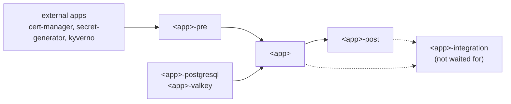

+++
title = "App Charts"
weight = 60
description = "Helm chart layout of the apps installed by the apps chart"
+++

Apps are Helm charts `kube/charts/app-<name>`, built on the `base` library chart and installed by the `apps` chart.
This page describes how an app chart splits its resources in several `HelmRelease`s (sub-HRs) so that they are
created in the right order.

## Installation

The `apps` chart (`kube/charts/apps`) has a registry of apps in its `apps` values, each in one or more groups
(`minimal`, `cluster`, `extra`). For each enabled app it creates:

- the namespace of the app, `<name>` by default (`namespace:` to change it)
- the service account `flux-<name>`, cluster-admin on the namespace of the app only
  (`clusterAdmin: true` for an app that installs cluster-scoped resources: CRDs, ClusterRoles, webhooks, ClusterIssuers...)
- the `HelmRelease` `app-<name>` installing `kube/charts/<appChart.name>` as `flux-<name>`

The resources of the chart are created in the namespace of its `HelmRelease`, so charts do not set a default
namespace. Resource names are the id of the resource: `prefixNamesWithRelease` is `false` by default in `base`.

## App values

The cluster values every app needs are the `app` values of the `app` library chart (`kube/charts/app`), which
inherits from `base`:

| Value | Description |
|---|---|
| `app.domain` | domain of the cluster |
| `app.name` | name of the cluster, deduced from the domain by default |
| `app.lldapdn` | base DN of lldap, deduced from the domain by default (`dc=example,dc=com`) |
| `app.lldapUsers` | users of the cluster, created in lldap and given an instance by some apps |

The `apps` chart computes them from its `config` and gives them to each app as a `global-values` ConfigMap in the
namespace of the app, used as `valuesFrom` of the `HelmRelease`. In an app chart they are read with `.Values.app.domain`,
`.Values.app.name`... and are required (`checkRequiredValues`).

An app chart declares both `app` and `base` in its `dependencies`, uses `app.loader.all` (or `app.loader.init` to
render with its own templates) instead of `base.loader.all`, and gets its default values merged with those of `app`
and `base`. Its editor schema (`schema/values.schema.json`) references `../app/schema/values.schema.json`, where the
`app` schema lives. A chart that does not use the cluster values (`app-external-secrets`, `app-gateway-api`) stays
on `base.loader.all`.

## Restoring the volumes of an app

The volumes of the apps are backed up daily by Longhorn into the bucket of Garage (the `default` group of recurring jobs). An
app can get its volumes back from the last backup when it is enabled, with `restore: true` in its entry of the `apps` chart. The
PVCs are not listed: nothing about them is declared in the chart of the app, the job finds the PVCs of the namespace in the
backups (Longhorn saves the namespace and the name of the PVC in each one, and the storage class and access mode are those of the
backed up volume).

```yaml
apps:
  tuwunel:
    restore: true
```

For such an app the `apps` chart also creates the HelmRelease `restore-<name>` (in `longhorn-system`, it waits for `app-longhorn` and
for the backup target of Garage), and `app-<name>` waits for it. Its job (`kube/charts/longhorn-restore`), for each PVC that does not
exist yet: syncs the backup target, finds the last completed backup of the PVC (Longhorn saves its namespace and name in the backup),
creates a Longhorn volume restored from it and the PV of this volume with a `claimRef` to the PVC, so the PVC of the app is bound to it
when it is created. It does nothing when the PVC exists, when there is no backup target or backup (the app starts empty), and fails (the
app waits, the job is retried) when the target is not reachable.

- The claim of the app has to use the same name, storage class and access mode as when it was backed up, and not ask for more than the size
  of the volume at that time. A PVC the app does not use anymore but that is in the backups is restored too: delete its PV.
- It is the flag that opts in, because the job needs rights on the whole cluster (PVs): they are given to the job, not to the apps.
- A CloudNativePG cluster is restored too (Longhorn saves the workload of the PVC in the backup). Its instances are one PVC: the job takes
  the most recent backup of any instance and creates it as `<cluster>-1`, with the labels and annotations of the operator (a PVC created
  by the operator would be initialised empty). When the `Cluster` is created the operator adopts the PVC, promotes it, sets the password of
  the `app` user from the new secret, and clones the other instances from it. Nothing is restored when a PVC of the cluster exists. There
  is no WAL archive: the transactions after the backup are lost.
- Only for the apps that keep all their state in their PVCs and databases, and not in the secrets: they are generated again, so an app
  whose data is encrypted with one (`authelia`, `lldap`) does not get it back. Not for `garage` (it holds the backups) nor `longhorn`.
- The backups are in the cluster itself (the bucket of Garage is on Longhorn volumes), so this restores an app that was removed or whose
  volume was lost, not a lost cluster.

## Sub-HRs

A chart does not create everything in its own release. A resource that needs something that does not exist yet
(a secret, a CRD, a running service) goes in a sub-HR created by the chart, which waits for it with `dependsOn`.
A sub-HR is either a chart of its own (`postgresql`, `valkey`: charts of this repository) or `./kube/charts/base-loader`,
which renders the `resources` given in its `values`.

| HR | Contains | Waits for | Waited for |
|---|---|---|---|
| `<app>-pre` | what the service needs to start: generated secrets (`stringSecrets`), certificates mounted by the pods, Kyverno policies | external apps (`app-cert-manager`, `app-secret-generator`, `app-kyverno`...) | yes |
| `<app>` | the service: public Helm chart, or `configMaps`, `deployments`, `services`, `persistentVolumeClaims` through `base-loader` | `<app>-pre`, `<app>-postgresql`, `<app>-valkey` | yes |
| `<app>-post` | resources of the CRDs declared by the service (Longhorn settings and storage classes, cert-manager ClusterIssuers, Kyverno policies, Cilium Gateway...) | `<app>` | yes |
| `<app>-integration` | public exposure: gateway certificate, `listenerSets`, `httpRoutes`, `tlsRoutes`, `referenceGrants` | `<app>-post` or `<app>`, `app-cert-manager`, `app-gateway-api` | no |

Rules:

- The service always starts after `-pre`: what a pod mounts or reads at start (a secret, a certificate) is in `-pre`,
  never in the service or in `-integration`.
- `-post` always starts after the service, because the CRDs it needs come with it.
- `-integration` starts after `-post` (or the service when there is none), but nothing waits for it:
  `install.disableWait` and `upgrade.disableWait` are `true`. A slow or failing public part (a rate limited
  Let's Encrypt certificate, a route not accepted) does not keep `app-<name>`, and the apps depending on it, from being ready.
  Its state is visible on its own `HelmRelease`.
- Only create the sub-HRs the app needs. `-pre` and `-post` are only for apps that have something to put in them.
- A sub-HR that has to depend on an app does it with `dependsOn` in the chart, not in the `apps` chart.
- A certificate that a pod mounts (`tls-lldaps`) is in `-pre`, the one only used by the Gateway (`lldap-gateway`) is in `-integration`.
- The sub-HRs of an app run as `flux-<name>`, they can only create resources in the namespace of the app, except for
  apps with `clusterAdmin`.
- The postgres cluster of an app is a sub-HR `<app>-postgresql` (chart `postgresql`) depending on `app-cert-manager`,
  `app-cnpg` and `app-longhorn`. The chart sets `prefixNamesWithRelease: true`, its resources are named `<release>-<id>`.
- The valkey of an app is a sub-HR `<app>-valkey` (chart `valkey`) depending on `app-secret-generator`. The chart wraps the public
  valkey chart: `valkey.auth.aclUsers` lists the users, whose passwords are generated in the secret `<app>-valkey` (one key per
  user), and `clients` lists the pods that can connect to it (network policy).



## Example

`app-lldap`:

```yaml
resources:
  fluxHelmReleases:
    lldap-postgresql:            # the database
      chart:
        spec:
          chart: ./kube/charts/postgresql
          ...

    lldap-pre:                   # secrets and certificate mounted by the pod
      dependsOn:
        cert-manager: { name: app-cert-manager, namespace: cert-manager }
        secret-generator: { name: app-secret-generator, namespace: secret-generator }
      chart:
        spec:
          chart: ./kube/charts/base-loader
          ...
      values:
        resources:
          stringSecrets: ...
          certManagerCertificates: ...

    lldap:                       # the service
      dependsOn:
        lldap-pre: { name: lldap-pre }
        lldap-postgresql: { name: lldap-postgresql }
      ...
      values:
        resources:
          configMaps: ...
          deployments: ...
          services: ...

    lldap-integration:           # exposed by the Gateway, not waited for
      install:
        disableWait: true
      upgrade:
        disableWait: true
      dependsOn:
        lldap: { name: lldap }
        cert-manager: { name: app-cert-manager, namespace: cert-manager }
        gateway-api: { name: app-gateway-api, namespace: gateway-api }
      ...
      values:
        resources:
          certManagerCertificates: ...
          listenerSets: ...
          httpRoutes: ...
          tlsRoutes: ...
```

Apps that are only static resources (`homer`, `jellyfin`, `landing`, `seerr`) put them in the `<app>` sub-HR, so that
`<app>-integration` has a service to wait for. `app-longhorn` has the four: `longhorn-pre` (NixOS PATH policy), `longhorn`
(the Helm chart), `longhorn-post` (settings, recurring jobs, storage and snapshot classes) and `longhorn-integration` (the UI).

## Exceptions

- `flux-integration` (`app-flux`, disabled by default) and `kube-integration` (`app-kube`) only have the public part,
  without a `-pre`, a service or a `-post` sub-HR. They are not waited for either, and wait for `app-gateway-api`
  (and `app-cert-manager` for flux), which these apps are installed before.
- `cert-manager-post`, `kyverno-post` and `cilium-post` only have resources of the CRDs of the service.

## Checking a chart

```bash
cd kube/charts/app-<name>
bcl k chart build   # unit tests, schema validation, renders ci/*-values.yaml into ci/*-result.yaml
```

`ci/*-result.yaml` shows every HR with its `dependsOn` and `disableWait`.
